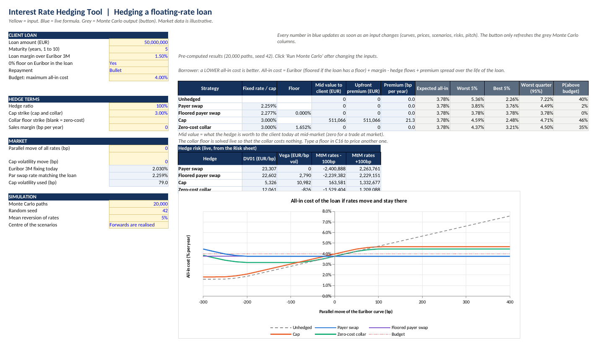
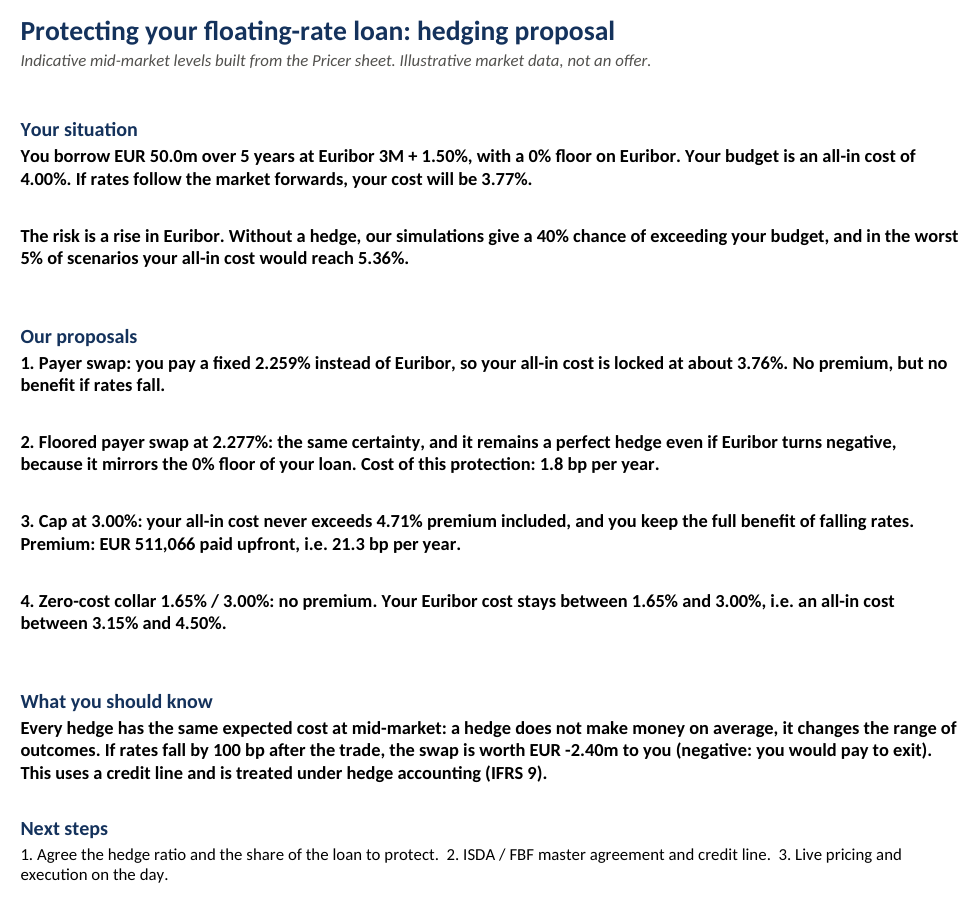

# Hedging a Floating-Rate Loan: an IRD Sales Case Study (Excel / VBA)

A French mid-cap has just borrowed **EUR 50m over 5 years at Euribor 3M + 1.50%**. Like most
European corporate loans, the loan has a **0% floor on Euribor**. Each quarter the company pays
the new Euribor fixing, so a rise in rates raises its financing cost straight away. The CFO has a
**budget of 4.00% all-in** and asks the bank's interest rate (IRD) sales desk how to protect it.

In this project I take the sales role. I build the EUR rate curves, price the hedges the desk
would propose, compare them on the same basis and turn the numbers into a recommendation for
the CFO. Everything is in one interactive Excel workbook.

## The client's problem

| | |
|---|---|
| Client | French mid-cap, EUR 50m loan, 5 years, bullet repayment |
| Loan | Euribor 3M + 1.50%, paid quarterly, 0% floor on Euribor |
| Risk | Euribor goes up, so the interest cost goes up |
| Budget | 4.00% all-in |
| Market | Euribor 3M fixing 2.03%, 5-year swap 2.31%, cap volatility about 79bp |

Doing nothing is a bet on rates. In our simulations the unhedged loan costs more than the
budget in **40% of scenarios**, and in the worst 5% it costs 5.36% a year.

## The four hedges an IRD sales would pitch

| Hedge | Idea for the client | Cost |
|---|---|---|
| **Payer swap** | Pay a fixed rate instead of Euribor | Free, no benefit if rates fall |
| **Floored payer swap** | Same, but it also mirrors the 0% floor of the loan | A slightly higher fixed rate |
| **Cap** | Insurance: Euribor is capped at 3.00%, falling rates still benefit the client | Premium paid upfront |
| **Zero-cost collar** | Euribor kept between a floor and a cap | Free, the benefit of falling rates stops at the floor |

## Results

| Hedge | Terms | Premium | Expected all-in | Worst 5% | Worst quarter | Above budget |
|---|---|---:|---:|---:|---:|---:|
| No hedge | | 0 | 3.78% | 5.36% | 7.22% | 40% |
| Payer swap | fixed 2.259% | 0 | 3.78% | 3.85% | 4.49% | 2% |
| Floored payer swap | fixed 2.277% | 0 | 3.78% | 3.78% | 3.78% | 0% |
| Cap | 3.00% | EUR 511k (21bp a year) | 3.78% | 4.59% | 4.71% | 46% |
| Zero-cost collar | 1.65% / 3.00% | 0 | 3.78% | 4.37% | 4.50% | 35% |

For a borrower, a **lower cost is better**. "Worst quarter" is the most expensive quarter of
the loan in the worst 5% of scenarios.

## What I would tell the CFO

- **Every hedge has the same expected cost.** At mid-market, a hedge does not save money on
  average. What it changes is the range of possible outcomes.
- **The plain swap is not a perfect hedge for this loan.** If Euribor turns negative, the
  company still pays at least 0% on the loan because of the floor, but on the swap it pays the
  fixed rate and also pays away the negative Euribor. The **floored swap** removes this gap for
  only 1.8bp a year. It is the only hedge that locks the budget in every scenario.
- **The cap keeps the benefit of falling rates, but it is expensive.** EUR 511k upfront
  (21bp a year). A 3.50% cap would cost about half, with a worst case 40bp higher.
- **The collar is the free alternative to the cap.** The company pays nothing, its Euribor cost
  stays between 1.65% and 3.00%, and it keeps part of the benefit if rates fall.
- **The mark-to-market matters.** If rates fall by 100bp after the trade, the swap is worth
  -EUR 2.4m to the company. This uses a credit line with the bank and has to be booked under
  hedge accounting (IFRS 9).

My recommendation: a **floored payer swap** on most of the loan, because the budget is the
priority. If the CFO wants to keep some upside, a **collar** on the rest.

The workbook writes this as a one-page proposal that updates when the inputs change:

